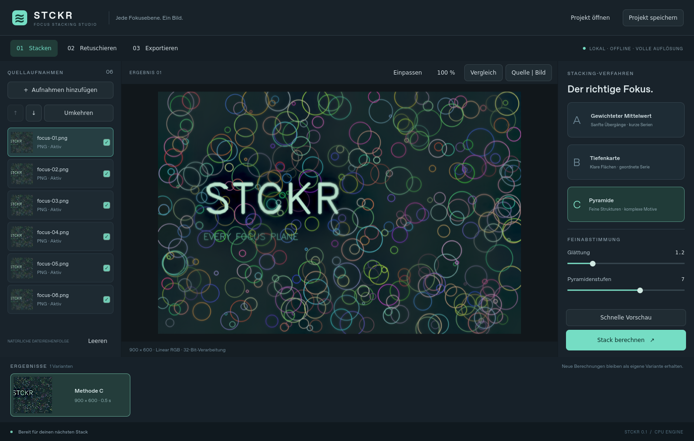

# STCKR

**Jede Fokusebene. Ein Bild.** Lokales Focus-Stacking-Studio für Windows mit deutscher Qt-Quick-Oberfläche, drei klassischen Verfahren und einer linearen RAW-Pipeline.



## Starten

Windows 10/11, 64-Bit. Das portable Paket aus den GitHub-Actions-Builds entpacken und `STCKR.exe` starten. Der vollständige Ordner muss zusammenbleiben. Python und Adobe DNG Converter werden nicht benötigt. Die Pakete sind noch nicht codesigniert.

Aus dem Quellcode mit Python 3.12 und [uv](https://docs.astral.sh/uv/):

```sh
uv sync --extra dev --frozen
uv run stckr
```

Die Linux-Entwicklungsumgebung benötigt zusätzlich die üblichen Qt-Systembibliotheken (unter anderem libEGL, libGL und xkbcommon). Unter Windows enthält das Anwendungspaket Qt und LibRaw. ExifTool wird beim Packaging über das gepinnte Vendor-Skript mitgeliefert; für Quellcode-Starts optional `python scripts/vendor_exiftool.py` ausführen.

## Workflow

1. CR3/RAW-, TIFF-, PNG- oder JPEG-Dateien ins Fenster ziehen. Ein Ordner wird auf seiner obersten Ebene eingelesen. Duplikate werden ignoriert.
2. Reihenfolge prüfen, Bilder ausschließen und A, B oder C auswählen. Für B müssen die Bilder in durchgehender Fokusreihenfolge liegen.
3. Optional eine **schnelle Vorschau** berechnen, anschließend **Stack berechnen** für die volle Auflösung.
4. Ergebnisvarianten vergleichen. Im Retuschebereich eine ausgerichtete Quelle links auswählen und im Ergebnis malen. Rechtsklick auf ein anderes Ergebnis wählt es als Pinselquelle, sofern Ausrichtung und Quellen identisch sind.
5. Als Linear-DNG (RAW-Serien), 16-Bit-sRGB-TIFF oder JPEG exportieren. Vorschau-Ergebnisse sind nicht exportierbar.
6. Projekt unter einem neuen Namen speichern. Die `.stckr`-Verzeichnisstruktur enthält Ergebnisse, ausgerichtete Quellen und Retuschierhistorie; Originale werden referenziert. Zum Öffnen darin `project.json` auswählen. Fehlende Originale können neu zugeordnet werden.

**Tastatur:** Strg+O Import, Strg+S Projekt speichern, Strg+Z Undo, Strg+Umschalt+Z / Strg+Y Redo, B Quellenpinsel, E Radierer, Bild↑/Bild↓ Quellenwechsel, Esc Abbruch. Mausrad zoomt, Ziehen verschiebt; während Retusche Strg+Ziehen oder mittlere/rechte Maustaste zum Verschieben. Doppelklick passt das Bild ein.

## Verfahren

- **A — Gewichteter Mittelwert:** lokale Gradientenenergie, geglättete und normalisierte Gewichte; kurze Stacks und sanfte Übergänge.
- **B — Tiefenkarte:** Schärfemaxima je Pixel, Medianbereinigung und kantenbewahrende Tiefenglättung; Auswahl unveränderter Quellpixel.
- **C — Pyramide:** Gauß-/Laplacian-Zerlegung, lokale Auswahl der Detailbänder, gemittelte Grundhelligkeit und Rekonstruktion; feine Strukturen und lange Serien.

Ausrichtung: benachbarte Bilder, SIFT/RANSAC, ECC-Verfeinerung, zusammengesetzte Transformationen, einmalige Lanczos-Abtastung und gemeinsamer gültiger Beschnitt. Standardmäßig werden Rotation, Translation und gleichmäßige Skalierung unterstützt; affine Verformung ist optional. Fehlgeschlagene Ausrichtung wird nicht still ignoriert.

## RAW und Farbe

CR3 wird mit rawpy/LibRaw gelesen und mit AHD demosaiziert. Die Verarbeitung bleibt im linearen Kamerafarbraum, mit explizit einheitlichem Weißabgleich, ohne automatische Aufhellung oder Tonkurve. Float32 erhält die Präzision während Ausrichtung, Fusion und Retusche. Die Vorschauentwicklung ist davon getrennt.

Der DNG-Export ist ein **16-Bit-Linear-DNG**, kein Bayer-Sensormosaik. Er enthält die XYZ→Kamera-Matrix aus LibRaw, Aufnahmeweißabgleich und einen RGB-Preview. Es werden keine proprietären Adobe-DCP-Profile behauptet. Farb- und Tonwertdarstellung kann daher von Adobe-eigenen Kameraprofilen abweichen. Belichtung/Wärme der Anzeige werden nicht ins DNG eingebrannt. Beim 16-Bit-Export werden Werte außerhalb des darstellbaren Bereichs begrenzt; die internen Float32-Daten bleiben erhalten.

RAW-Serien müssen von derselben Kamera mit passender Farbmatrix und Bildgröße stammen. Gemischte Kameras oder RAW/RGB-Mischungen werden abgewiesen. TIFFs benötigen sRGB oder kein Profil; abweichende TIFF-ICC-Profile und Alphakanäle werden explizit zurückgewiesen. JPEG/PNG mit ICC-Profil werden über LittleCMS nach sRGB konvertiert.

## CLI und Beispielserie

```sh
uv run stckr demo demo-stack
uv run stckr stack demo-stack/focus-*.png --method C --no-align -o result.tif
uv run stckr stack IMG_0001.CR3 IMG_0002.CR3 --method B -o result.dng
```

Unter PowerShell Dateinamen einzeln angeben; Wildcards werden dort von Python nicht automatisch expandiert. Weitere Optionen: `uv run stckr stack --help`. Bestehende Exporte benötigen in der CLI `--overwrite`.

## Ressourcen und Projekte

Ausgelegt auf 16 GB RAM und bis zu 100 × 24 MP. Dateien werden nacheinander decodiert; die komplette Serie liegt nie als Float32-Array im RAM. Standardmäßiger Engine-Rahmen 4096 MB, höchstens vier OpenCV-Threads. Dekodierte und ausgerichtete lineare Daten liegen als speicherabgebildete `.npy`-Dateien im lokalen Cache. **Für 100 Bilder können einschließlich Ergebnissen mehr als 60 GB freier SSD-Speicher nötig sein.** Weitere Varianten benötigen zusätzlichen Platz. Projekte kopieren die ausgewählten Ergebnisdaten und sind entsprechend groß.

Der Cache liegt im Qt-Anwendungscache (`STCKR/STCKR/sessions`). Er bleibt zum Schutz ungespeicherter Ergebnisse nach dem Beenden erhalten und kann nach dem Speichern der Projekte im Dateimanager gelöscht werden. Originaldateien werden nie verändert. Retuschierhistorien sind im Projekt persistent; ein unterbrochener laufender Pinselstrich ist keine abgeschlossene Undo-Transaktion.

## Tests und Builds

```sh
uv run pytest
uv run ruff check src tests scripts
uv run python scripts/smoke_gui.py
uv run python scripts/benchmark.py --frames 100 --width 6000 --height 4000
uv run python scripts/vendor_exiftool.py
uv run pyinstaller STCKR.spec --noconfirm
```

Windows- und Linux-CI führen Engine-, DNG- und GUI-Smoke-Tests aus. Der Windows-Job erzeugt ein portables Anwendungspaket. Details und tatsächlich ausgeführte Prüfungen: [docs/VALIDATION.md](docs/VALIDATION.md).

Ein direkter Gleichwertigkeitsnachweis zu Helicon Focus ist **nicht** erbracht. Die App implementiert dieselben drei Verfahrensklassen eigenständig. Lightroom/Camera-Raw-Sichtprüfung und Vergleiche an echten Makroserien sind gesonderte Abnahmeschritte.

## Herkunft

Eigenständige Implementierung, inspiriert von den öffentlich dokumentierten Verfahrensklassen von [Helicon Focus](https://www.heliconsoft.com/focus/help/english/HeliconFocus.html), dem RAW-Workflow von [Helicon](https://www.heliconsoft.com/raw-in-dng-out/) sowie den vom Auftraggeber genannten Projekten [OpenFocus](https://github.com/Xinzhe99/OpenFocus) und [Shine Stacker](https://github.com/lucalista/shinestacker). Kein proprietärer Code und keine Logos dieser Produkte wurden übernommen. Siehe [THIRD_PARTY_NOTICES.md](THIRD_PARTY_NOTICES.md).
